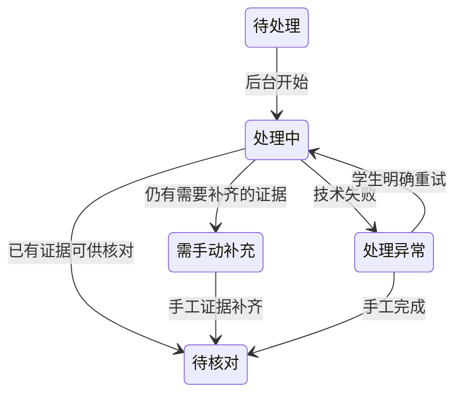

# 文字层优先与腾讯免费OCR策略

用户于2026-10-25确认的最终流程。上传限制与云端识别限制独立。

## 上传确认后的处理

1. 上传整理窗口只整理文件，不做识别。学生确认后后台任务继续跨页面运行。
2. 代码逐页检查PDF既有文字与字符坐标，不调用AI，也不调用OCR。原生电子PDF和带OCR文字层的扫描PDF都可直接读取。
3. 可用文字层直接本地提取并保存原页字符位置，供本人参与证据和AI分析使用，超过12页同样适用。文字层提取不是本地OCR，不安装识别模型。
4. 无可用文字层的短文件（不超过12页）逐页使用腾讯高精度OCR；长扫描文件只处理首页、末页文字，用于提取活动名和时间，中间页不调用云OCR，本人参与信息由学生自行定位框选。同小项其他附件独立处理。
5. 印章单独处理：所有文件只检查首页与末页，单页文件仅检查一次；只取最后一枚。未找到则不生成自动章图，提示学生去原件自行寻找、手动框选。长原生PDF虽不用文字OCR，仍进行首末页查章；已有文字层不能代替印章检测。
6. 腾讯继续只用免费资源包，账户后付费保持关闭。本地月预算是额外保护，不能当成腾讯共享免费余额。额度或预算不足时停止剩余云调用，保留已完成结果并显示未覆盖内容。
7. 火山MediaKit保留为文字识别备选，不在正式流程中自动回退或调用。

## 文字层质量和页面定位

不是“搜索得到一两个字就跳过整份OCR”。每页检查有效文字量、乱码比例、字符位置及扫描大图覆盖。只有页码/页眉覆盖在大扫描图上的页面会回到扫描页分支；混合PDF逐页处理。

使用现有PDFium引擎读取原文与逐字坐标，并转换到同一原件渲染像素，支持PDF旋转和裁边。原生提取的置信度为空，不伪造云OCR置信度。原件SHA参与缓存，防止画面相同但隐藏文字层不同的文件错误复用。原页和上下文截图仍由学生与审核员核对。

## AI上下文

本地保留全部成功文字与坐标。给AI的文字优先选择本人姓名/学号匹配位置、文件首末页及适量邻页，控制总长度，并明确标注摘选范围；不把数百页无关人员名单全部发送给模型。AI仍须生成具体活动名称和依据，学生可修改并手动计分。

## 历史与手工分支

旧策略成功任务不绕过新规则。旧失败不会自动发起云重试；已冻结或批准的材料不改写。工作稿中不符合新策略的旧自动证据不作为当前建议显示，学生手工证据保留。纯手工分支是任务正常完成的一种结果，不显示为OCR故障，也不会让AI永久等待。

## 页面状态与等待提示

处理进度、文字覆盖、证据完整性和审核状态分开表达。学生只看到“待处理、处理中、待核对、需手动补充、处理异常”这五类材料主状态；原生、混合、首末页识别是处理方式说明，不再各自生成另一套主状态。AI分析及人工审核保留独立状态，自动处理结束不代表审核通过。

| 材料主状态 | 含义 | 学生下一步 |
| --- | --- | --- |
| 待处理 | 已确认上传，尚在排队 | 等待，或查看原件 |
| 处理中 | 检查文字层、读取现有文字或云识别正在进行 | 可切换站内页面，无需重复点击 |
| 待核对 | 自动部分已结束，当前所需证据已有来源 | 对照原件，确认名称、分值和截图 |
| 需手动补充 | 仍缺本人参与位置或必要证据，或额度不足留下缺口 | 按具体提示定位、框选、填写 |
| 处理异常 | 技术错误导致本次处理未完成 | 查看原因，明确重试或手工处理 |

每份文件展示“已经处理哪些页、尚缺哪些页或证据、下一步怎么做”。例如“直接读取56/56页”“已识别首末2/56页，中间本人参与信息请手动框选”“已读取8页、云识别2页”。文字未提取完时只显示检查进度，不提前把长文件判成扫描件。免费额度不足保留成功部分并给出停止原因；仅无章不作为技术故障，指向原件手动寻找。已有手工证据解除对应补充提醒。

一个小项可包含多个文件，参与主图、名称、时间和盖章可分别来自不同附件，不要求每份附件都补齐同一套证据。人工补齐所需证据后进入待核对；“自动只覆盖首末2/56页”仍照实保留，不把人工框选伪装成全文识别。已有文字层不消耗文字OCR额度，首末页印章检测仍独立使用腾讯免费印章额度。

排队、检测文字层、云文字/印章识别、AI等待材料、AI整理条目均提供阶段提示。运行中醒目告知处理可能需要一些时间，可切换站内页面，后台继续，完成后自动更新，避免重复点击。显示真实已耗时与实际进度，不使用固定承诺时长或伪倒计时；忙提示在任务结束后移除。

## 离线验证

原生文本解析测试覆盖真实渲染像素位置、PDF旋转/裁边、无字扫描、仅页码文字覆盖扫描、混合页面和损坏文件。用户指定的两个现有PDF逐页验证结果：56页文件全部可提取，约5.1万非空白字符；234页文件全部可提取，约23.8万字符。纯本地提取约3秒和16秒，未调用OCR或AI；这些耗时不包含上传、初次渲染和数据库持久化。

真实文件及检查报告仅保存在本机忽略目录，不随代码发布。回归与界面验收使用虚构材料和模拟云接口，不消耗免费额度。
