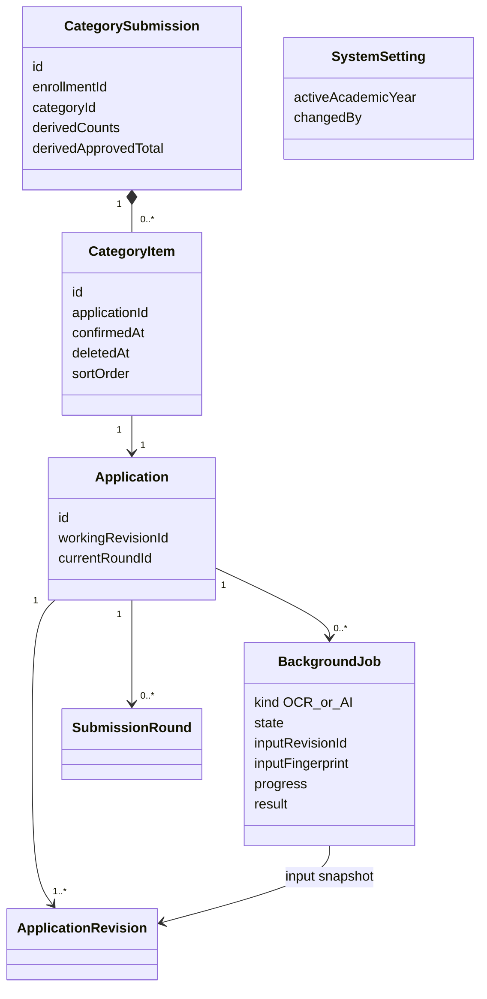
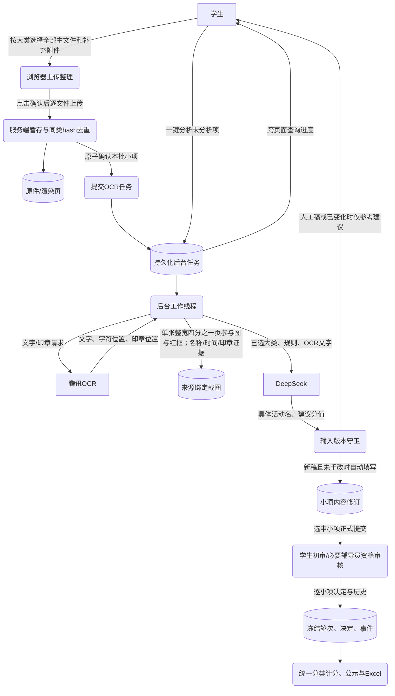
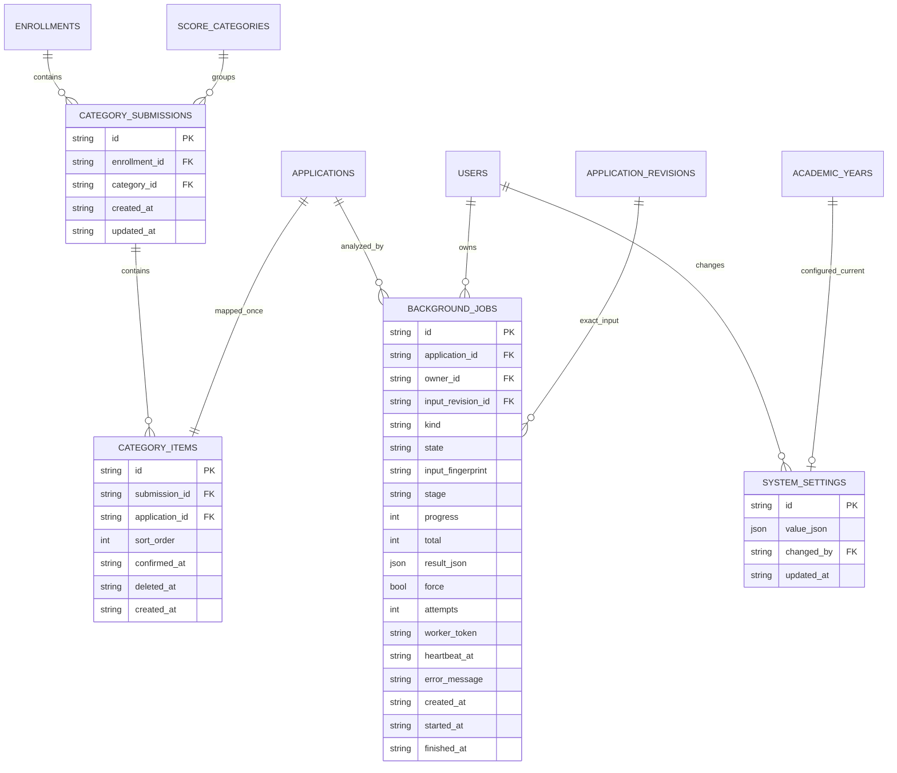

# V2批量申报增量设计

需求依据：[Q34—Q39确认记录](../docs/改版需求对齐-V2.md)。本版增加4张表，共37张；原33表及冻结内容、审核轮次、奖项替代恢复关系保留。原Visual Paradigm工程及14张图作为V1归档，以下是当前V2差异。

## UML：大类、小项与任务

一份大类申报不持有独立审核决定；审核和计分都针对小项的当前有效轮次。通过小项只读，其余小项可以增补、撤回、修改或按允许状态软删。

## 数据流

上传整理过程中不发OCR请求；未确认暂存小项不能识别或正式提交。所有任务属于用户和具体小项、内容版本，离开页面不会取消。只允许明确的系统截图变更推进同输入的后续AI快照，人工变化不能被忽略。

## ER：新增表及原模型关联

`category_submissions(enrollment_id,category_id)`与`category_items(application_id)`唯一。`system_settings.value_json.year_id`保存当前学年逻辑引用，由服务验证，不是物理外键列。岗位和带班范围仍用原RBAC授权交集；管理员指定学年不因此取得业务材料权限。

迁移先使用SQLite在线备份，再为旧申请建立分组。已通过历史证据不自动改写或消耗云额度；新生成证据按V2布局，原件始终保持不变。公示脱敏仍失败封闭，红框元数据不向普通同学暴露学号文本。
